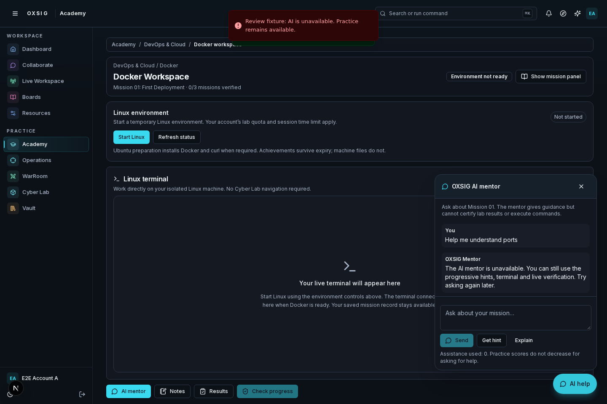
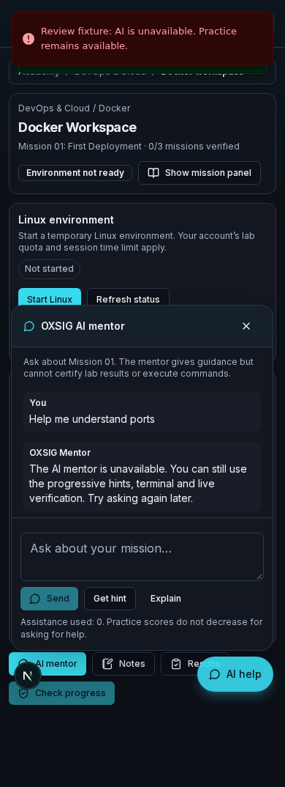

# Academy PR 264 interface review

These are actual Chromium captures of the running Next.js application, not design mockups. Desktop is 1440 × 960; mobile is 390 × 960 with full-page captures.

The original six captures are from `e7ccfb286eb281196a443b3756a77996ef85bad8`; the mentor and full mobile-roadmap captures below are refreshed from verified source `34e65cbab222fd341f09de65619df58f425e1734`. Browser fixture account, lab responses and verified progress are synthetic. The terminal placeholder accurately shows a machine that has not been started. A separate browser test mounts the actual SSM terminal component with unavailable transport and confirms that panels preserve its DOM instance. These images do not demonstrate a live AWS connection.

## Screenshots

| Academy home | DevOps roadmap |
| --- | --- |
|  |  |

| Desktop Docker workspace | Server-derived verified state fixture |
| --- | --- |
|  |  |

| Mobile workspace | Mobile mission drawer |
| --- | --- |
|  |  |

| Desktop mentor | Mobile mentor |
| --- | --- |
|  |  |

[Full mobile DevOps roadmap](roadmap-390.png)

## Verified checks

Full CodeBuild run `oxsig-ci:29c94999-fe2f-4fbb-8948-83bc36fa78a5` succeeded on source `34e65cbab222fd341f09de65619df58f425e1734`. The final follow-up commit adds only these review artifacts and documentation. It installs pinned pnpm 10.28.0 and uses a disposable local PostgreSQL database.

- `pnpm typecheck`: passed.
- `pnpm test:run`: 1,077 Vitest tests passed; 6 skipped. All 84 additional Node checks passed.
- `pnpm db:verify`: schema checks and 6 database integration tests passed.
- `pnpm build`: passed, including built-route and WebSocket checks.
- Server syntax, source reachability, persistence policy and environment contract checks: passed.
- Chromium: mentor evidence (2), sandbox commerce (2), Academy mission-first (7), simulator (2), Docker workspace resume/failure (2), design review (4): 19 passed.
- Independent screenshot/design build `oxsig-ci:972314aa-2415-4c23-8788-6bbfb3d2e953`: all 4 design-review tests passed.

The design tests check straight node/beam geometry, active and verified states, reduced motion, planned previews, direct Docker navigation, desktop/mobile panels, clipboard-only commands, mentor keyboard behavior, terminal preservation and Operation protection.

## Follow-up fixes and remaining verification

AWS access was restored and the failed build was diagnosed: mobile navigation to the optional simulator asserted its heading before client hydration and the saved-state response completed. The test now waits for the real simulator state response, requires HTTP 200, and asserts the destination URL before the heading. It retains the existing heading and overflow assertions.

Workspace notifications appear at the top, leaving the floating mentor controls accessible. The new trial-click regression passed at desktop and mobile widths, including the AI-unavailable state. Both the full run and independent design-review run succeeded. The previous authentication and CI blockers are resolved.

No live EC2 provisioning, SSM transport or real AI-provider calls were exercised for this UI review. Before learner release, smoke-test launch, readiness, terminal reconnect, mission verification and expiry in a disposable authorized lab.

## Availability and setup

Docker is the only playable skill in the career roadmaps: deploy → repair → persist, using existing trusted mission verification. Linux Fundamentals, Networking, Kubernetes, Python, Active Directory and all other career subjects remain labeled curriculum previews.

These UI refinements introduce no migrations, environment variables, AWS permissions or services. Existing Docker Academy setup still applies: migrations through 068, Clerk/CSRF, PostgreSQL, lab AWS configuration and the managed terminal bridge; see [Docker learning workspace](../../docker-learning-workspace.md).

Keep PR 264 draft for interface review. Do not merge or deploy.
