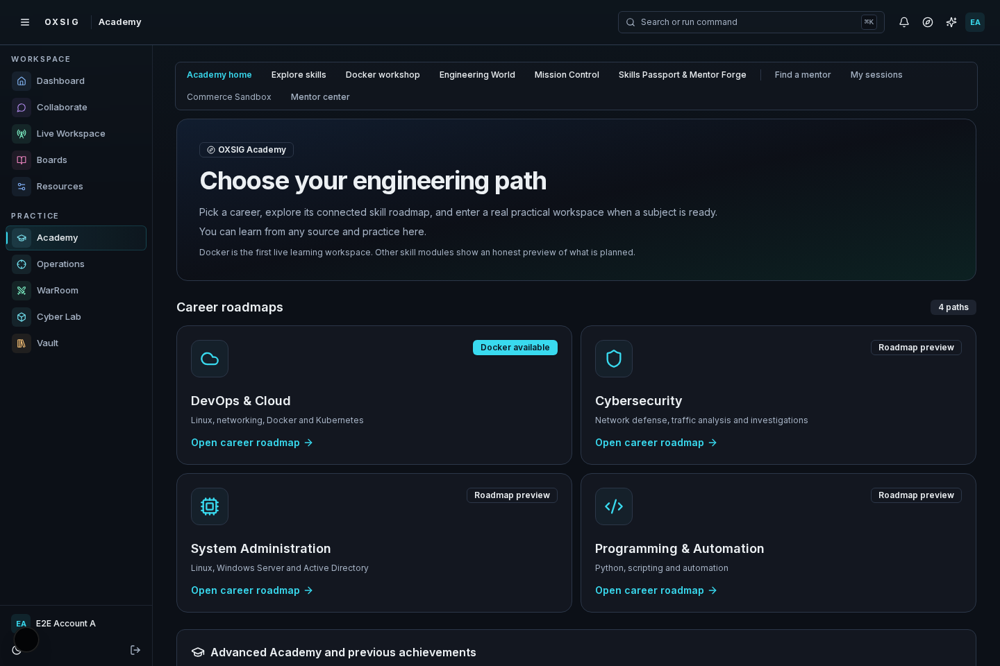
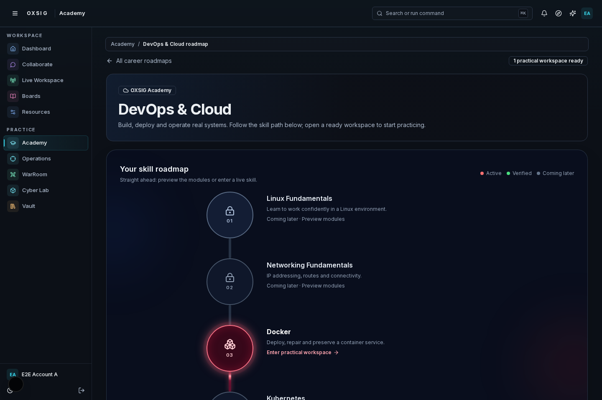
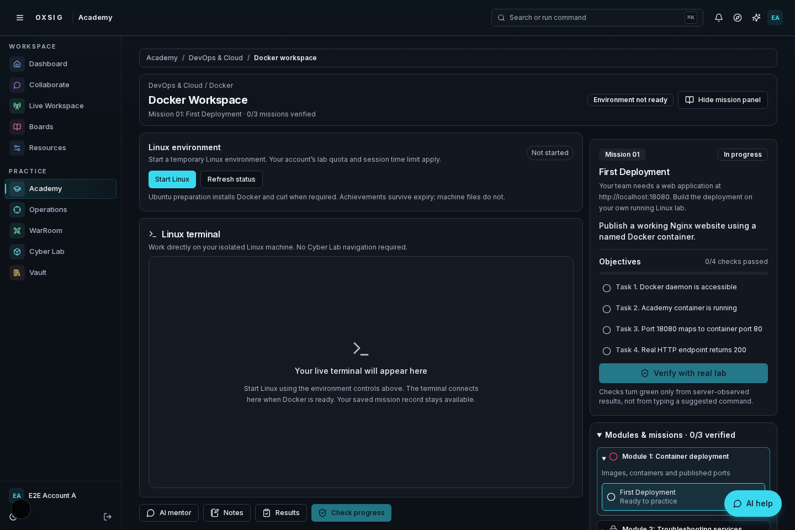
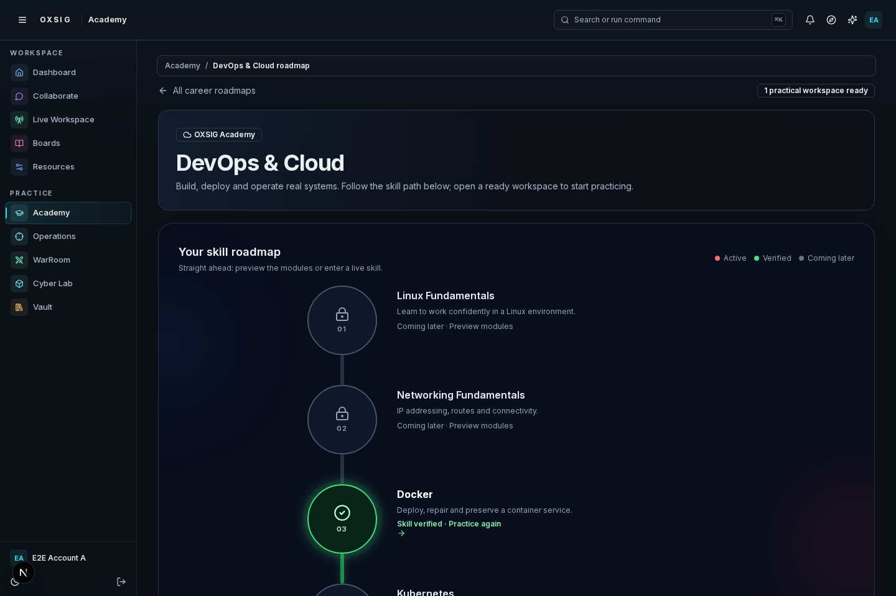
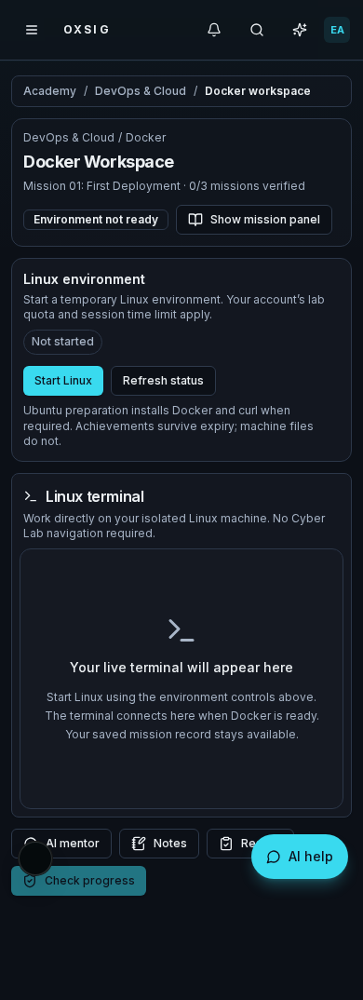
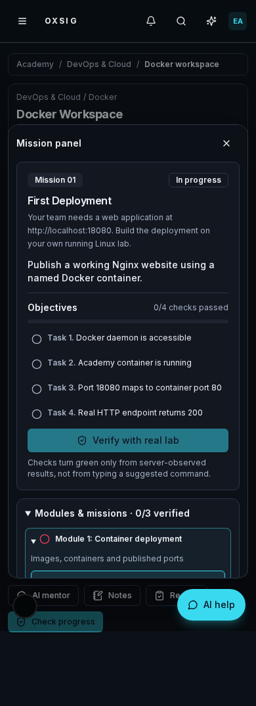

# Academy PR 264 interface review

These are actual Chromium captures of the running Next.js application, not design mockups. Desktop is 1440 × 960; mobile is 390 × 960 with full-page captures.

Captured revision: `e7ccfb286eb281196a443b3756a77996ef85bad8`. Browser fixture account, lab responses and verified progress are synthetic. The terminal placeholder accurately shows a machine that has not been started. A separate browser test mounts the actual SSM terminal component with unavailable transport and confirms that panels preserve its DOM instance. These images do not demonstrate a live AWS connection.

## Screenshots

| Academy home | DevOps roadmap |
| --- | --- |
|  |  |

| Desktop Docker workspace | Server-derived verified state fixture |
| --- | --- |
|  |  |

| Mobile workspace | Mobile mission drawer |
| --- | --- |
|  |  |

## Verified checks

Full CodeBuild run `oxsig-ci:081d631f-5fcd-4199-948b-2e0479930bb4` succeeded on the captured revision. It installs pinned pnpm 10.28.0 and uses a disposable local PostgreSQL database.

- `pnpm typecheck`: passed.
- `pnpm test:run`: 1,077 Vitest tests passed; 6 skipped. Additional Node checks passed.
- `pnpm db:verify`: schema checks and 6 database integration tests passed.
- `pnpm build`: passed, including built-route and WebSocket checks.
- Server syntax, source reachability, persistence policy and environment contract checks: passed.
- Chromium: mentor evidence (2), sandbox commerce (2), Academy mission-first (7), simulator (2), Docker workspace resume/failure (2), design review (4): 19 passed.
- Independent screenshot/design build `oxsig-ci:6804b1d7-a300-48d1-b411-62ca9834053a`: all 4 design-review tests passed.

The design tests check straight node/beam geometry, active and verified states, reduced motion, planned previews, direct Docker navigation, desktop/mobile panels, clipboard-only commands, mentor keyboard behavior, terminal preservation and Operation protection.

## Latest refinement and remaining verification

After reviewing the screenshots, workspace notifications were moved to the top so they cannot cover the floating mentor. The new regression uses a Playwright trial click to ensure that control remains accessible after an AI error. That later revision's build `oxsig-ci:35a4a64e-4c60-4c86-913c-f0a8b75df220` reports failure; its cause is unresolved because the AWS connector stopped returning build/log access and repeatedly requests authentication. Do not describe that later revision as passing. Reconnect AWS Core, inspect the failed build logs, fix the cause and rerun the full checks before approving.

No live EC2 provisioning, SSM transport or real AI-provider calls were exercised for this UI review. Before learner release, smoke-test launch, readiness, terminal reconnect, mission verification and expiry in a disposable authorized lab.

## Availability and setup

Docker is the only playable skill in the career roadmaps: deploy → repair → persist, using existing trusted mission verification. Linux Fundamentals, Networking, Kubernetes, Python, Active Directory and all other career subjects remain labeled curriculum previews.

These UI refinements introduce no migrations, environment variables, AWS permissions or services. Existing Docker Academy setup still applies: migrations through 068, Clerk/CSRF, PostgreSQL, lab AWS configuration and the managed terminal bridge; see [Docker learning workspace](../../docker-learning-workspace.md).

Keep PR 264 draft for interface review. Do not merge or deploy.
