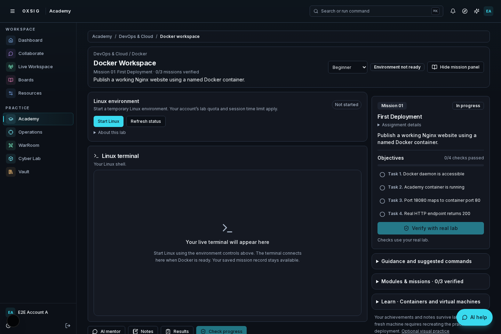
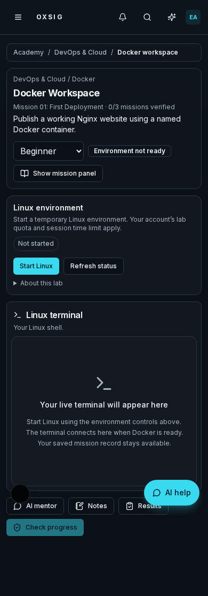
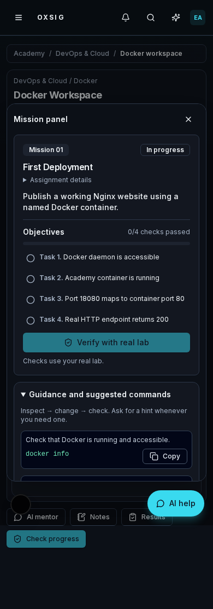

# DevOps workspace review — PR 265

Actual Chromium captures of the running Next.js app, from verified code `5718d35380ae3f7a2be5117d9c220bbac1a7c980`.
Lab and AI responses use review fixtures; these screenshots do not demonstrate live AWS or model-provider calls.

| Mobile workbench | Beginner command guidance |
| --- | --- |
|  |  |

[Full 13-skill DevOps roadmap](roadmap-390.png)

## Experience

The objective and coaching selector stay visible. Assignment detail, module tree,
lab explanation and terminal connection notes expand on request. Actionable
terminal notices remain visible. The terminal itself is the existing SSM component.

- Beginner: explained diagnostic commands and progressive concrete hints.
- Intermediate: diagnostic commands and hypothesis-based hints.
- Advanced: evidence questions, with no initial command list.
- Worked commands require explicit reveal, recorded through the existing hint
  counter. Copy never executes a command. All modes use the same trusted verification.

The roadmap covers Linux, networking, Git, scripting, cloud, Docker, CI/CD,
infrastructure as code, Kubernetes, observability, DevSecOps, reliability and a
capstone. **Only Docker is playable. All other skills are labeled previews.**
Practice Docker remains accessible without completing planned subjects.

## Verification

Full CodeBuild run `oxsig-ci:7d7c4267-536f-4493-89ac-6cfe9149b0f3` succeeded on the code revision above:

- `pnpm typecheck`: passed.
- `pnpm test:run`: 1,080 Vitest tests passed; 6 skipped. All 84 Node checks passed.
- `pnpm db:verify`: schema validation and 6 database integration tests passed.
- `pnpm build`: passed, including route and WebSocket checks.
- Server syntax, source reachability, persistence and environment checks passed.
- Chromium: mentor evidence (2), commerce (2), Academy journeys (7), simulator (2),
  Docker resume/recovery (2), design/coaching review (5): **20 passed**.

Browser checks cover all three help modes, deliberate solution disclosure,
assistance recording without verification, clipboard behavior, 13-node geometry,
reduced motion, mobile overflow, terminal preservation and Operation safety.
The follow-up gallery commit contains only review documentation and screenshots.

No migrations, new services, permissions or deployment variables. Live EC2,
SSM transport and AI-provider behavior were not exercised in this review.
Keep this new design PR in draft for interface review.
